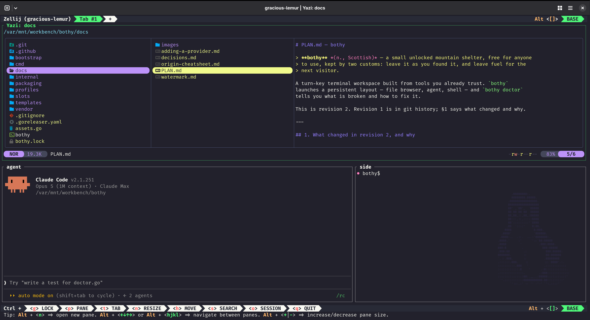

# bothy

A terminal workspace assembled from tools you already have. One command opens a
file browser, an agent and a shell in one window, configured and checked.

```sh
cd ~/code/api
bothy
```

<p align="center">
  
</p>

A bothy is an unlocked shelter in the Scottish hills: somewhere to work for a
while and leave as you found it.

## What it does

bothy checks what is already installed. It uses the tools it finds and names
them; for the ones that are missing it lists them, asks before downloading
anything, and verifies each download against a checksum it ships. It then writes
its own configuration into a directory of its own, points each tool there for
the length of the session, arranges the panes and opens the window. Afterwards
it reports what is wrong, if anything, and what to type to fix it.

Closing the window leaves the machine as it was. Uninstalling removes the
directory bothy wrote, and names the few things it cannot remove for you.

The same sequence with the reasons for its order:
[what happens when you type bothy](https://github.com/bspeelm/bothy/wiki/What-happens-when-you-type-bothy).

## Install

You need **git**. Everything else bothy brings or tells you how to get. A
terminal that carries the Kitty keyboard protocol — Ghostty, Kitty, WezTerm,
iTerm2 — allows Shift+Enter and Ctrl+Enter to reach the agent pane; in anything
else bothy opens a Ghostty window to get them. An AI agent is optional, and is
what the middle pane is for.

| | |
|---|---|
| **Fedora** | `sudo dnf copr enable bspeelman/bothy && sudo dnf install bothy` |
| **Debian, Ubuntu, Mint** | download the `.deb` from [the latest release](https://github.com/bspeelm/bothy/releases/latest), then `sudo apt install ./bothy_*.deb` |
| **macOS** | `brew install --cask bspeelm/bothy/bothy` |
| **Windows** | `scoop bucket add bothy https://github.com/bspeelm/scoop-bothy && scoop install bothy` — [in beta](https://github.com/bspeelm/bothy/wiki/Where-it-runs) |
| **you already have Go** | `go install github.com/bspeelm/bothy/cmd/bothy@latest` |

Then, from any directory:

```sh
bothy
```

The first run lists what is missing, asks before downloading anything, and then
opens the window. It takes longer than later runs and happens once per machine.

### If none of those fit

There is an install script, and one case where it is the better answer: an
image-based system such as Fedora Silverblue, where `dnf` means `rpm-ostree` and
a reboot for a binary that runs from `~/.local/bin`. It needs no root and layers
nothing onto the host.

```sh
curl -fsSL https://raw.githubusercontent.com/bspeelm/bothy/main/bootstrap/install.sh | sh
```

The cost is that the script is fetched over HTTPS and run unsigned, before bothy
exists to verify anything. No signature on a later artifact changes that; it is
the same trade as any `curl | sh`.

There are seven ways in, counting source, and each verifies what it fetched
differently.
[All of them, and what checks what](https://github.com/bspeelm/bothy/wiki/Installing) ·
[what bothy downloads and what that proves](https://github.com/bspeelm/bothy/wiki/Security)

## Commands

Four are used daily:

| | |
|---|---|
| `bothy` | open the workspace |
| `bothy tower` | watch every running agent in one window |
| `bothy doctor` | what is wrong, and what to type (`--json` for machine use) |
| `bothy config set <key> <value>` | change a setting |

There are nineteen in total.
[All of them, with their flags](https://github.com/bspeelm/bothy/wiki/Commands) ·
[how to read a doctor report](https://github.com/bspeelm/bothy/wiki/The-doctor)

## The parts it assembles

bothy has five slots — terminal, multiplexer, browser, editor, agent — and each
is a name in a configuration file. Change one, run `bothy install`, and bothy
reports what that stack can and cannot provide. The defaults are Ghostty,
Zellij, Yazi, your `$EDITOR` and `claude`.

Only the multiplexer slot requires Go to extend, because it reads the layout and
writes the multiplexer's own format. Everything else is described by data.
[Swapping parts, and theming](https://github.com/bspeelm/bothy/wiki/Swapping-parts-and-theming).

## What it touches

```
~/.local/share/bothy/     bothy's own: configuration, and any tool it fetched
~/.config/bothy/          yours: settings, palette, overrides
```

Nothing else — not `~/.config/yazi`, not `~/.vimrc`, not `~/.bashrc`, not your
git configuration. bothy writes into its own directory and, at launch, points
each tool there using environment variables that last for the session and are
then gone.

The second directory is yours. Commit it, clone it on another machine, run
`bothy`, and the workspace is the same one.

`bothy uninstall` removes the first directory and the binary, and names what it
leaves rather than leaving you to find it.

[Using your own tool configuration instead of bothy's](https://github.com/bspeelm/bothy/wiki/Swapping-parts-and-theming) ·
[what uninstall leaves, and why](https://github.com/bspeelm/bothy/wiki/Installing#removing-it)

## Watching several agents

Several sessions across several windows, each with an agent working, cannot be
read at once. `bothy tower` puts every running agent in one window.

```
$ bothy tower
watching 3 agent(s), side by side; 2 pane(s) expanded to be worth reading
```

Each pane mirrors one agent. Move between them with `Alt+h/j/k/l` and type a
reply into whichever is waiting; it reaches that agent as if typed in its own
window. The bottom rows of a mirror are reserved for your reply, so it stays on
screen while the agent above continues.

The tower reads panes and sends nothing of its own. It composes no message,
answers nothing on your behalf and sends nothing on a timer: everything an agent
receives came from your keyboard. It attaches to no session, so watching one
cannot disturb it.

It expands each watched pane to fill its own window first, because a mirror can
only show what its pane displays and a cockpit layout gives its agent about a
quarter of the screen. Those panes are restored when the tower closes.
[The tower, in full](https://github.com/bspeelm/bothy/wiki/The-tower#why-it-expands-the-panes-it-watches).

## Toolboxes

A toolbox is a container that shares your home directory while keeping its own
installed packages. On Fedora Silverblue they are the normal place to install
software, and it is easy to accumulate several — one per kind of work.

The tooling around them is thin: `toolbox list` prints a table no script can
read, there is no `toolbox stop`, and stopping one requires a `podman` command
that is unavailable from inside a toolbox. bothy manages them from a session and
records which toolbox each project belongs in.

```
$ bothy box ls
* dev                      22 busy   bothy-api
  docs                     exited
  legacy                   idle      bothy-legacy
```

`bothy box` reports which toolbox this project uses and why; `use`, `create`,
`stop` and `rm` do the obvious things. The first time you open a project bothy
asks which toolbox to use and records the answer; with one toolbox, or none, it
does not ask.

bothy does not replace `toolbox`, which still creates the containers and enters
them. bothy tracks which project goes where.
[The full rules](https://github.com/bspeelm/bothy/wiki/Toolboxes).

## Another machine

`bothy connect <client>` opens the workspace against a different machine: the
file browser shows its files, the shell pane is a login session on it, and the
agent works on its files.

```
$ bothy connect <client>
<client> mounted at ~/.local/share/bothy/cache/remotes/<client>
```

bothy puts nothing on the machine you connect to — not itself, not a tool, not a
credential, not a temporary file. The only thing it uses there is the SSH server
already running. If you can `ssh <client>` today, you can
`bothy connect <client>`.

The workspace runs on your own machine, so sessions, `bothy ls` and
`bothy attach` behave as usual and a dropped connection costs the mount rather
than the session. Inside the workspace, `on make test` runs a command on the
remote machine in the corresponding directory. It requires sshfs locally, and
bothy gives you the command if it is missing.
[How it works, in full](https://github.com/bspeelm/bothy/wiki/Connecting).

## Confining the agent

The agent slot runs a command with everything you can reach: every repository,
`~/.ssh`, your shell history. That is the access it would have if you started it
by hand, so bothy does not make it worse — but bothy owns the launch, which is a
position from which to make it better.

`bothy confine` runs the agent pane in a rootless podman container. Nothing else
changes: the same layout, the same file browser, the same shell. It is opt-in and
there is no setting that enables it.

What it prevents: access to every other project, `~/.ssh`, `~/.aws`, your shell
history and the rest of `$HOME`. Verified rather than assumed — from inside the
pane, those paths do not exist.

Three things are allowed deliberately. The agent's own credentials are mounted,
or it cannot log in and the boundary protects nothing you wanted. The network is
open, because the agent calls its API: this is a filesystem boundary, not a
network one. And the project directory is mounted writable, because editing it
is the purpose.
[Setting it up, the toolbox case, configuration and cleanup](https://github.com/bspeelm/bothy/wiki/Walling-off-the-agent).

## Where it runs

Linux and macOS. Fedora, Ubuntu, Debian and Arch are installed, exercised and
uninstalled in containers on every release, and macOS on a real Mac. That is
what supported means here. Windows is in beta: it is built, published and
documented, and not yet in that set. Silverblue and the Debian derivatives
receive advice bothy cannot test in a container, and says so.

[Which terminals, which stacks, and what is untested](https://github.com/bspeelm/bothy/wiki/Where-it-runs).

## Scope

bothy is a configurator and a launcher. It is not a plugin marketplace or an
extension API, not an LSP or debugger manager, and not a bundle of the tools: it
downloads their official releases and verifies them against `bothy.lock`. It
runs no background service, no auto-updater and no telemetry.

It does not manage your agent's configuration, keys or hooks, and it is not a
sandbox unless you ask for one. By default the agent runs as you, in your
repository, with your permissions; its edits and commits are real and are not
bothy's to undo. Uninstalling removes bothy and its tools, and nothing the agent
did.

There is no Flatpak. Flathub does not accept command-line software, and bothy
downloads tools as it goes, which Flatpak packaging exists to prevent.

## Compatibility

Within a major version: the `config.toml` keys, the profile and palette schemas,
the two directories, and the shape of `doctor --json`. `config.toml` carries
`schema = 1`.

Maintenance releases will continue. The features listed here are the ones it
ships with and is expected to keep.

[What that obliges, and what is deliberately not covered](https://github.com/bspeelm/bothy/wiki/What-you-can-depend-on).

## Contributing

See [`docs/adding-a-provider.md`](docs/adding-a-provider.md). Adding a tool
bothy fetches is one configuration file; adding one it configures is a file and
some templates. Only the multiplexer requires Go. If anything else appears to,
that is a gap in the provider format — please report it.

The project's aims are in [`docs/north-star.md`](docs/north-star.md), the
reasoning behind each decision in [`docs/decisions.md`](docs/decisions.md), and
the plan in [`docs/PLAN.md`](docs/PLAN.md).

## Authorship

bothy began as a cheat sheet for making one development setup portable, handed
to an agent to apply on a new machine. It was then built as an exercise in
shipping software with an AI-led workflow, deliberately on a project where the
stakes were low.

The architecture, the constraints and the decisions are the maintainer's; Claude
planned and implemented within them. The decisions are recorded in
[`docs/decisions.md`](docs/decisions.md) and the rules Claude worked under are in
[`CLAUDE.md`](CLAUDE.md).

Claude wrote most of the code. The load-bearing paths and their tests have since
been reviewed by hand, with particular attention to the install script, the
uninstall path and the container invocation. The rest is held in place by
process: the test suite, the code and comment budgets enforced in the Makefile,
and review by AI systems other than the one that wrote the code.

## Credits and licence

MIT — see [`LICENSE`](LICENSE).

The built-in palette is [Dracula](https://github.com/dracula/dracula-theme),
also MIT. bothy does not bundle the tools it installs: it downloads their
official releases, verifies them, and each keeps its own licence.
[`NOTICE`](NOTICE) lists them all.
